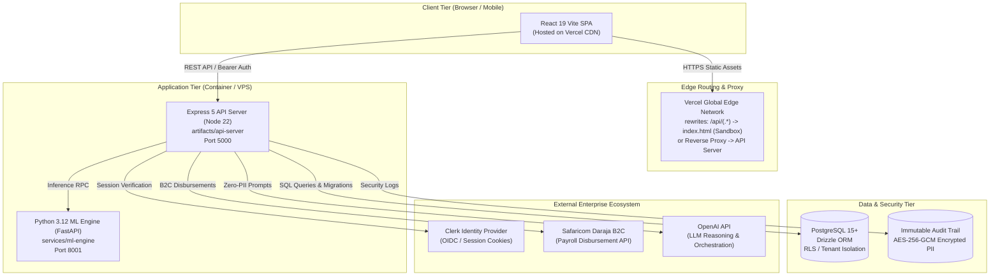

# Rekker PeopleOS — Architecture & Topology Audit

## 1. System Topology Overview

---

## 2. Core Package Responsibilities

| Package Path | Package Name | Role & Architecture Boundary |
|---|---|---|
| `artifacts/peopleos` | `@workspace/peopleos` | React 19 SPA, Tailwind v4, Lucide icons, TanStack React Query v5. Communicates strictly with OpenAPI client. |
| `artifacts/api-server` | `@workspace/api-server` | Express 5 HTTP REST API. Encapsulates business logic, statutory calculations, audit logging, and RBAC. |
| `lib/api-client-react` | `@workspace/api-client-react` | Orval-generated React Query hooks, custom fetch wrapper, and fallback sandbox store. |
| `lib/api-zod` | `@workspace/api-zod` | TypeScript type declarations and Zod request/response validation contracts generated from OpenAPI 3.0. |
| `lib/db` | `@workspace/db` | Drizzle ORM schema definitions, relationship maps, and SQL migration files. |
| `services/ml-engine` | N/A (Python Service) | Standalone FastAPI microservice providing XGBoost & scikit-learn models for workforce demand and attrition forecasting. |
| `artifacts/mockup-sandbox` | `@workspace/mockup-sandbox` | Isolated development environment for rapid component styling and visual regression testing. |
