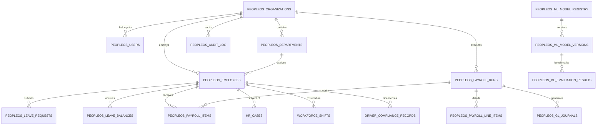

# Rekker PeopleOS — Database & Drizzle Schema Audit

## 1. Entity Relationship Model Overview

---

## 2. Drizzle Schema File Index

| Schema Path | Tables Defined | Key Fields & Security Constraints |
|---|---|---|
| `lib/db/src/schema/index.ts` | `peopleos_organizations`, `peopleos_users`, `peopleos_employees`, `peopleos_departments`, `peopleos_audit_log` | Composite index on `(organization_id, work_email)`. Encrypted PII stored via `national_id_encrypted` with AES-256-GCM. |
| `lib/db/src/schema/payroll.ts` | `peopleos_payroll_runs`, `peopleos_payroll_items`, `peopleos_payroll_line_items`, `peopleos_gl_journals` | Maker-checker dual control fields: `prepared_by_user_id`, `approved_by_user_id`. Check constraints ensure Debits == Credits in GL journals. |
| `lib/db/src/schema/leave.ts` | `peopleos_leave_policies`, `peopleos_leave_balances`, `peopleos_leave_requests` | Foreign keys enforce employee integrity. Leave balance deductions enforce non-negative balances unless approved for advance. |
| `lib/db/src/schema/phase2CoreHr.ts` | `employee_documents`, `employee_lifecycle_events`, `bulk_import_batches` | Records lifecycle milestones (probation, promotion, separation) with full user attribution. |
| `lib/db/src/schema/phase4WorkforceErp.ts` | `workforce_shifts`, `workforce_equipment_certs`, `driver_compliance_records`, `sales_territories`, `sales_commissions` | NTSA license tracking with `license_expiry_date` index and `psv_badge_number`. |
| `lib/db/src/schema/phase5AiGovernance.ts` | `peopleos_ml_model_registry`, `peopleos_ml_model_versions`, `peopleos_ml_evaluation_results`, `peopleos_human_approval_queue` | Complete provenance metadata tracking for AI recommendations and scikit-learn/XGBoost models. |

---

## 3. Migration Register

Migrations located in `lib/db/migrations/`:
- `0001_initial_schema.sql` — Core users, roles, organizations, and audit infrastructure.
- `0002_kenya_payroll.sql` — Statutory tax bands, PAYE, NSSF Tier I/II, SHA, and housing levy support.
- `0003_leave_and_approvals.sql` — Leave policies and multi-tier approval flows.
- `0004_core_hr_phase2.sql` — Bulk employee import staging tables and organization hierarchy.
- `0005_confidential_hr_cases.sql` — HR grievance and disciplinary cases with firewall segregation.
- `0006_workforce_erp_phase4.sql` — Shift rosters, commercial driver compliance, and plant production zones.
- `0007_ai_governance_phase5.sql` — Model registries, evaluation results, and human approval queues.
