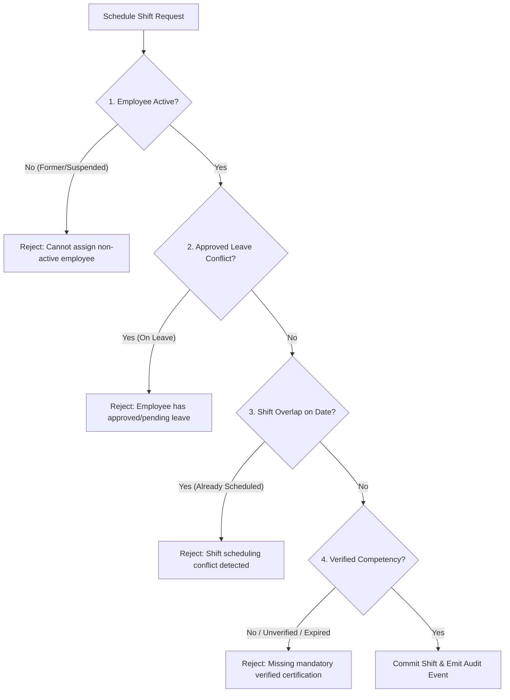

# Rekker PeopleOS — Phase 4
## Production Scheduling, Shift Conflict Prevention & Competency Engine

---

## 1. Manufacturing Lines & Operational Work Zones

Rekker industrial operations require distinct line configurations, staffing thresholds, and safety certifications:

### Standard Production Lines

| Line Code | Name | Zone | Min Staffing | Operating Window | Cost Centre | Required Competencies |
|---|---|---|---|---|---|---|
| `LINE-MFG-01` | Automated Formulation & Mixing Bay A | Formulation Line A | 3 Operators | 06:00 - 22:00 (2 Shifts) | `CC-MFG-01` | Chemical Safety Protocol, GMP Cleanroom |
| `LINE-MFG-02` | High-Speed Automated Packaging Line B | Automated Filling Line B | 6 Operators | 06:00 - 22:00 (2 Shifts) | `CC-MFG-01` | Equipment Safety Protocol, High-Speed Packaging |
| `LINE-MFG-03` | Cleanroom Quality & Analytical Lab | Quality Control Bay C | 2 Operators | 08:00 - 17:00 (Day Shift) | `CC-MFG-02` | GMP Cleanroom Protocol, Analytical QC |

---

## 2. Shift Scheduling Engine & Validation Gates

When a shift is scheduled via `POST /api/workforce-erp/shifts`, the scheduling engine executes four mandatory validation gates before committing the record:

### Validation Gate 1: Employee Master State
- Checks `employeesTable` for active membership in the requesting organization.
- Strictly blocks former employees (`status === 'former'`) or suspended personnel.

### Validation Gate 2: Approved Leave Conflict Detection
- Cross-references `leaveRequestsTable` for `status === 'approved'` or `status === 'pending'` overlapping `shiftDate`.
- Prevents shift allocation if an employee is taking annual, sick, maternity/paternity, or study leave.

### Validation Gate 3: Overlapping Shift Detection
- Queries existing `workforceShiftAssignmentsTable` records on `shiftDate` for the target employee with `status === 'scheduled'`.
- Enforces statutory daily limit and prevents double-booking across different production lines or facilities.

### Validation Gate 4: Competency & Certification Verification
- If a production line or shift template demands a required competency (e.g. `Very Narrow Aisle (VNA) Turret Operator` or `GMP Cleanroom Protocol`), verifies whether the employee holds a certification that is:
  1. Exact competency or equipment type match.
  2. Status is `verified` (not `pending_verification`, `rejected`, or `revoked`).
  3. Expiration date is strictly greater than or equal to `shiftDate`.

---

## 3. Peer Shift Swaps Workflow

Employees can propose shift swaps with peer operators without managerial intervention until final signoff:

1. **Submission (`POST /api/workforce-erp/shift-swaps`):** Requesting employee specifies `requestingShiftAssignmentId`, `targetEmployeeId`, and mandatory justification `reason`.
2. **Validation:** System checks that the swap request is not with oneself, verifies that `requestingShiftAssignmentId` belongs to the applicant, and records `status: 'pending'`.
3. **Supervisor Decision (`POST /api/workforce-erp/shift-swaps/:id/decision`):**
   - An authorized `production_supervisor` or `warehouse_supervisor` reviews the proposal.
   - If approved: system automatically swaps employee IDs on the scheduled shifts, updates records to `swapped`, and records a permanent audit event.
