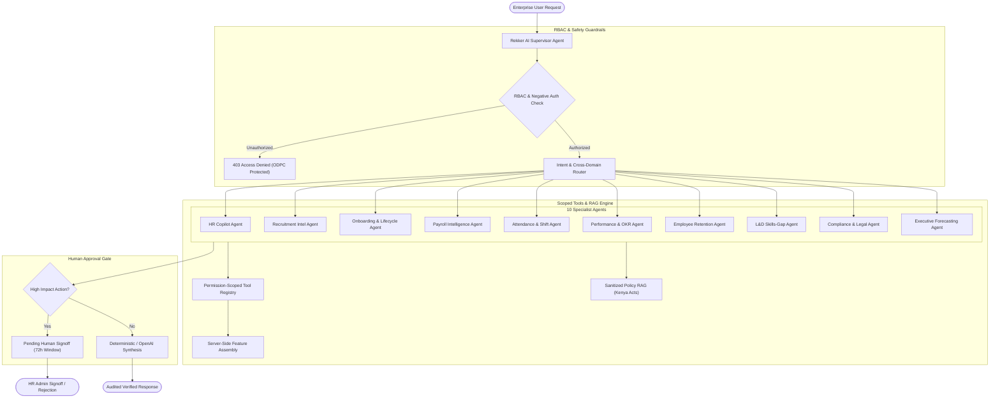

# Rekker PeopleOS — Phase 5: Multi-Agent Architecture & Specialist Orchestration

## 1. Executive Summary

Phase 5 transforms the AI layer in **Rekker PeopleOS** into an enterprise-grade multi-agent intelligence ecosystem designed strictly under **Responsible AI** and **Kenya Data Protection Act 2019 (ODPC)** principles.

The platform coordinates a **Supervisor Agent** and **10 Domain Specialist Agents**, ensuring:
1. **Dynamic Intent Routing**: Queries are analyzed and routed across specialized domain agents.
2. **Cross-Domain Collaboration**: Complex workforce scenarios (such as shift shortages or contract expirations) trigger collaborative reasoning across multiple specialists (e.g., Retention + Attendance + Learning + Executive).
3. **Strict Negative Authorization (RBAC)**: Role-based guardrails prevent unauthorized access to sensitive organization-wide payroll, compensation, executive attrition scores, or audit logs.
4. **Human-in-the-Loop Approval Gating**: Autonomous execution of high-impact employment actions (such as salary adjustments, contract terminations, or payroll disbursements) is strictly blocked; actions are queued as formal proposals requiring explicit human administrative signoff.

---

## 2. Agent Registry & Specialist Domain Ownership

| Agent ID | Display Name | Core Responsibility | Mandatory Collaborators |
| :--- | :--- | :--- | :--- |
| `supervisor` | **Rekker AI Supervisor** | Global intent classification, RBAC scope enforcement, multi-agent coordination | Copilot, Payroll, Compliance, Executive |
| `copilot` | **HR Copilot Agent** | Workforce self-service, employee directory, leave balance queries | Compliance, Onboarding |
| `recruitment` | **Recruitment Intelligence** | ATS candidate ranking, job description semantic criteria matching (no protected traits) | Onboarding, Compliance |
| `onboarding` | **Onboarding & Lifecycle** | 30-60-90 day checklists, asset allocations, probation reviews, offboarding clearances | Copilot, Compliance |
| `payroll` | **Payroll Intelligence** | Versioned Kenya PAYE, NSSF, SHIF, AHL calculations, M-Pesa disbursements & anomaly audits | Compliance, Executive |
| `attendance` | **Attendance Intelligence** | Duplicate clock-in detection, shift balance optimization, overtime variance flagging | Payroll, Retention |
| `performance` | **Performance Intelligence** | OKR momentum tracking, milestone z-score analysis, review scaffolding | Learning, Retention |
| `retention` | **Employee Retention** | XGBoost turnover prediction, NLP workplace sentiment & burnout early warnings | Payroll, Attendance, Performance |
| `learning` | **Learning & Development** | Competency matrix gap mapping, statutory certification compliance tracking | Performance, Onboarding |
| `compliance` | **Compliance Monitoring** | Kenya Employment Act 2007 citations, KRA statutory deadlines, ODPC PII protection | Payroll, Onboarding |
| `executive` | **Executive Intelligence** | Headcount demand forecasting, budget gap utilization, holistic board briefings | Retention, Payroll, Compliance |

---

## 3. Strict Negative Authorization & Tenant Isolation

Standard employee accounts (`role: employee`) operate within strict self-service boundaries:
- **Disallowed Queries**: Organization-wide salary lists, executive turnover forecasts, unmasked statutory identifiers, peer disciplinary records, and system audit logs.
- **Enforcement**: Evaluated before invoking any tool or downstream model. Violations immediately terminate with HTTP `403 Forbidden` citing ODPC boundaries.
- **Tenant Scope**: Every query is strictly isolated by `organizationId`. Multi-tenant queries across organizational boundaries are fundamentally impossible.

---

## 4. Human-in-the-Loop Gating Protocol

High-impact consequential actions cannot execute autonomously. When an agent proposes or detects intent for:
- `MODIFY_COMPENSATION`: Critical risk.
- `APPROVE_AND_DISBURSE_PAYROLL`: Critical risk.
- `TERMINATE_EMPLOYMENT_CONTRACT`: Critical risk.
- `OVERRIDE_STATUTORY_CONFIG`: High risk.

The platform creates an audited proposal in `peopleos_ai_approval_requests` with:
- `riskLevel`: `critical` | `high` | `medium` | `low`
- `expiresAt`: 72-hour window
- `payloadJson`: Proposed parameters and rationale
- `status`: `pending`

Only users with administrative roles (`hrAdmin`, `payrollOfficer`, `systemAdmin`) can review and decide proposals via `POST /api/ai/approvals/:id/decision`.
