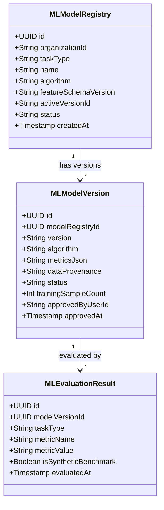

# Rekker PeopleOS — Phase 5: Python ML Engine & Model Governance

## 1. Overview

Rekker PeopleOS integrates a real Python 3.14 machine-learning engine running **Scikit-learn** and **XGBoost**. The ML workload is executed via a hardened bidirectional subprocess bridge (`cli.py` / `mlBridge.ts`) or dedicated microservice HTTP container (`ML_SERVICE_URL`).

Eight distinct predictive and diagnostic ML tasks are operational:

1. **`attrition`**: XGBClassifier gradient boosted trees with local standardized logistic feature impact scoring and 95% confidence intervals.
2. **`workforce_forecast`**: Scikit-learn Ridge regression modeling historical joiners/leavers with 95% uncertainty bands and headcount capacity gap estimation.
3. **`candidate_match`**: TF-IDF n-gram vectorizer with Cosine similarity and experience weighting; excludes all protected demographic traits.
4. **`payroll_anomalies`**: IsolationForest multivariate outlier detection combined with robust Median Absolute Deviation (MAD) Z-score thresholding.
5. **`attendance_anomalies`**: IsolationForest pattern recognition paired with deterministic duplicate same-day punch event rules.
6. **`skills_gap`**: Multi-dimensional competency gap analyzer measuring verified employee qualifications against production line and departmental requirements.
7. **`sentiment`**: Workplace NLP sentiment and burnout classifier using TF-IDF n-grams and Logistic Regression.
8. **`performance_trends`**: Milestone completion momentum analysis using statistical standard deviation distribution scoring.

---

## 2. Model Governance Schema & Lineage

The system persists model lineage and validation metadata in PostgreSQL via Drizzle ORM:

- **`peopleos_ml_model_registry`**: High-level task definitions and active version bindings.
- **`peopleos_ml_model_versions`**: Specific evaluated versions (`1.2.0`), algorithm hyperparameters, training sample count, and approval state (`development`, `evaluated`, `approved`, `deployed`, `retired`).
- **`peopleos_ml_evaluation_results`**: Fine-grained quantitative validation results (e.g., CV ROC-AUC: `0.84`, CV F1: `0.78`, MAE: `0.42`).
- **`peopleos_ai_tool_audit_logs`**: Immutable execution log capturing actor user, agent role, tool name, input hash, execution latency, and data provenance.

---

## 3. Human Approval of Model Deployments

In compliance with AI Governance:
1. Evaluated models must receive explicit human signoff before deployment into production workflows.
2. Administrative endpoint `POST /api/ml/models/:id/approve` verifies administrative authorization (`hrAdmin`, `systemAdmin`, `executive`), sets `status = "approved"`, stamps the approver user ID and timestamp, and records an audit log.
