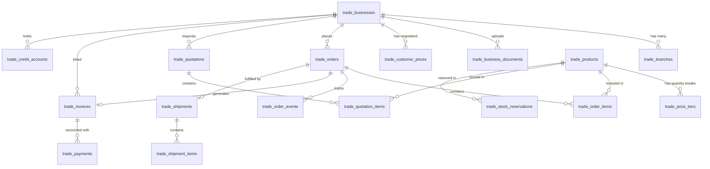

# Rekker Trade — Database Design & Entity Relationship Specification

**Database Engine:** PostgreSQL 16  
**ORM:** Drizzle ORM  
**Naming Standard:** snake_case tables and columns, plural nouns, UUID primary keys  
**Monetary Rules:** All monetary values stored as `integer` minor units (cents in KES, 1 KES = 100 cents), avoiding floating-point inaccuracies.  
**Timestamps:** UTC timestamps (`timestamp({ withTimezone: true })`) formatted for `Africa/Nairobi` (EAT).

---

## 1. Domain Entity Relationship Diagram

---

## 2. Core Tables and Column Definitions

### 1. `trade_businesses` (B2B Customers & Organizations)
- `id`: `uuid` PK defaultRandom()
- `legalName`: `text` NOT NULL (e.g., "Nairobi Supermarket Enterprises Ltd")
- `tradingName`: `text` NOT NULL (e.g., "Nairobi Central Mart")
- `businessType`: `text` NOT NULL (enum: `'retailer'`, `'wholesaler'`, `'distributor'`, `'strategic'`)
- `registrationNumber`: `text` NOT NULL UNIQUE
- `kraPin`: `text` NOT NULL (encrypted / masked)
- `taxComplianceValid`: `boolean` NOT NULL DEFAULT true
- `status`: `text` NOT NULL DEFAULT `'under_review'` (enum: `'draft'`, `'submitted'`, `'under_review'`, `'approved'`, `'rejected'`, `'suspended'`)
- `primaryContactName`: `text` NOT NULL
- `primaryEmail`: `text` NOT NULL
- `primaryPhone`: `text` NOT NULL
- `creditLimit`: `integer` NOT NULL DEFAULT 0 (in cents, e.g. KES 500,000 = 50,000,000 cents)
- `creditTerms`: `text` NOT NULL DEFAULT `'cash'` (enum: `'cash'`, `'net_7'`, `'net_14'`, `'net_30'`, `'net_60'`)
- `assignedSalesRepId`: `text` (references employee ID in PeopleOS)
- `tierDiscountPct`: `integer` NOT NULL DEFAULT 0 (percentage discount for category tier)
- `createdAt`, `updatedAt`: `timestamp` with timezone

### 2. `trade_branches` (Delivery Locations & Outlets)
- `id`: `uuid` PK defaultRandom()
- `businessId`: `uuid` NOT NULL REFERENCES `trade_businesses.id` ON DELETE CASCADE
- `branchName`: `text` NOT NULL (e.g., "CBD Main Branch", "Industrial Area Warehouse")
- `code`: `text` NOT NULL
- `physicalAddress`: `text` NOT NULL
- `county`: `text` NOT NULL (e.g., "Nairobi", "Mombasa", "Nakuru")
- `deliveryInstructions`: `text`
- `contactPerson`: `text` NOT NULL
- `contactPhone`: `text` NOT NULL
- `purchasingLimitPerOrder`: `integer` DEFAULT 0
- `isActive`: `boolean` NOT NULL DEFAULT true
- `createdAt`, `updatedAt`: `timestamp` with timezone

### 3. `trade_products` (Catalogue & Packaging Conversions)
- `id`: `uuid` PK defaultRandom()
- `sku`: `text` NOT NULL UNIQUE (e.g., "SAF-GLOW-100ML-CTN")
- `barcode`: `text` (EAN-13 / UPC)
- `name`: `text` NOT NULL (e.g., "Saffron Milan Glow Radiance Lotion 100ml")
- `brand`: `text` NOT NULL (enum: `'Saffron Milan'`, `'Bio Saff'`, `'Cornells'`, `'PetCare'`)
- `category`: `text` NOT NULL (e.g., "Skincare", "Personal Care", "Pet Grooming")
- `description`: `text` NOT NULL
- `packagingUnit`: `text` NOT NULL DEFAULT `'carton'` (enum: `'piece'`, `'pack'`, `'carton'`, `'case'`)
- `unitsPerCarton`: `integer` NOT NULL DEFAULT 24 (pieces per master carton)
- `packsPerCarton`: `integer` NOT NULL DEFAULT 4
- `basePricePerCarton`: `integer` NOT NULL (in cents, e.g., KES 4,800 = 480,000 cents)
- `unitCostPrice`: `integer` NOT NULL (in cents, for internal margin protection)
- `minOrderQuantityCartons`: `integer` NOT NULL DEFAULT 1
- `stockOnHandCartons`: `integer` NOT NULL DEFAULT 0
- `allocatedStockCartons`: `integer` NOT NULL DEFAULT 0
- `reorderThresholdCartons`: `integer` NOT NULL DEFAULT 20
- `imageUrl`: `text`
- `status`: `text` NOT NULL DEFAULT `'active'` (enum: `'active'`, `'low_stock'`, `'out_of_stock'`, `'discontinued'`)
- `createdAt`, `updatedAt`: `timestamp` with timezone

### 4. `trade_price_tiers` (Volume Breaks & Commercial Rules)
- `id`: `uuid` PK defaultRandom()
- `productId`: `uuid` NOT NULL REFERENCES `trade_products.id` ON DELETE CASCADE
- `customerCategory`: `text` NOT NULL (enum: `'all'`, `'retailer'`, `'wholesaler'`, `'distributor'`)
- `minQuantityCartons`: `integer` NOT NULL (e.g., 10, 50, 100 cartons)
- `unitPriceCents`: `integer` NOT NULL
- `discountPercentage`: `integer` NOT NULL DEFAULT 0
- `validFrom`: `date`
- `validTo`: `date`
- `createdAt`: `timestamp` with timezone

### 5. `trade_orders` (B2B Orders & Processing)
- `id`: `uuid` PK defaultRandom()
- `orderNumber`: `text` NOT NULL UNIQUE (e.g., "ORD-2026-0301")
- `businessId`: `uuid` NOT NULL REFERENCES `trade_businesses.id` ON DELETE RESTRICT
- `branchId`: `uuid` REFERENCES `trade_branches.id`
- `placedByUserId`: `text` NOT NULL
- `poReference`: `text` (Customer Purchase Order number)
- `status`: `text` NOT NULL DEFAULT `'submitted'` (enum: `'draft'`, `'submitted'`, `'approved'`, `'processing'`, `'picking'`, `'packed'`, `'dispatched'`, `'in_transit'`, `'delivered'`, `'completed'`, `'cancelled'`)
- `subtotalCents`: `integer` NOT NULL
- `discountCents`: `integer` NOT NULL DEFAULT 0
- `taxCents`: `integer` NOT NULL DEFAULT 0 (16% VAT)
- `totalCents`: `integer` NOT NULL
- `paymentStatus`: `text` NOT NULL DEFAULT `'pending'` (enum: `'pending'`, `'partial'`, `'paid'`, `'credit_extended'`)
- `paymentTerms`: `text` NOT NULL DEFAULT `'cash'`
- `deliveryNotes`: `text`
- `approvedByUserId`: `text`
- `approvedAt`: `timestamp` with timezone
- `createdAt`, `updatedAt`: `timestamp` with timezone

### 6. `trade_order_items` (Order Item Lines)
- `id`: `uuid` PK defaultRandom()
- `orderId`: `uuid` NOT NULL REFERENCES `trade_orders.id` ON DELETE CASCADE
- `productId`: `uuid` NOT NULL REFERENCES `trade_products.id` ON DELETE RESTRICT
- `sku`: `text` NOT NULL
- `productName`: `text` NOT NULL
- `packagingUnit`: `text` NOT NULL DEFAULT `'carton'`
- `quantity`: `integer` NOT NULL
- `unitPriceCents`: `integer` NOT NULL
- `subtotalCents`: `integer` NOT NULL
- `discountCents`: `integer` NOT NULL DEFAULT 0
- `totalCents`: `integer` NOT NULL
- `createdAt`: `timestamp` with timezone

### 7. `trade_quotations` (RFQs & Commercial Negotiations)
- `id`: `uuid` PK defaultRandom()
- `quotationNumber`: `text` NOT NULL UNIQUE (e.g., "QT-2026-0012")
- `businessId`: `uuid` NOT NULL REFERENCES `trade_businesses.id` ON DELETE RESTRICT
- `requestedByUserId`: `text` NOT NULL
- `assignedSalesRepUserId`: `text`
- `status`: `text` NOT NULL DEFAULT `'issued'` (enum: `'draft'`, `'issued'`, `'negotiating'`, `'accepted'`, `'rejected'`, `'expired'`, `'converted'`)
- `subtotalCents`: `integer` NOT NULL
- `discountCents`: `integer` NOT NULL DEFAULT 0
- `totalCents`: `integer` NOT NULL
- `validUntil`: `date` NOT NULL
- `customerNotes`: `text`
- `internalMarginPct`: `integer` (hidden from customer)
- `convertedToOrderId`: `uuid`
- `createdAt`, `updatedAt`: `timestamp` with timezone

### 8. `trade_invoices` (B2B Tax Invoices & Aging)
- `id`: `uuid` PK defaultRandom()
- `invoiceNumber`: `text` NOT NULL UNIQUE (e.g., "INV-2026-1044")
- `orderId`: `uuid` NOT NULL REFERENCES `trade_orders.id` ON DELETE RESTRICT
- `businessId`: `uuid` NOT NULL REFERENCES `trade_businesses.id` ON DELETE RESTRICT
- `totalCents`: `integer` NOT NULL
- `paidCents`: `integer` NOT NULL DEFAULT 0
- `balanceDueCents`: `integer` NOT NULL
- `status`: `text` NOT NULL DEFAULT `'issued'` (enum: `'draft'`, `'issued'`, `'partial'`, `'paid'`, `'overdue'`)
- `dueDate`: `date` NOT NULL
- `etimsControlCode`: `text` (KRA Fiscal electronic invoice signoff)
- `createdAt`, `updatedAt`: `timestamp` with timezone

### 9. `trade_payments` (Payment Transactions & Reconciliation)
- `id`: `uuid` PK defaultRandom()
- `receiptNumber`: `text` NOT NULL UNIQUE (e.g., "REC-2026-0492")
- `invoiceId`: `uuid` REFERENCES `trade_invoices.id`
- `businessId`: `uuid` NOT NULL REFERENCES `trade_businesses.id` ON DELETE RESTRICT
- `amountCents`: `integer` NOT NULL
- `paymentMethod`: `text` NOT NULL (enum: `'mpesa'`, `'bank_transfer'`, `'cheque'`, `'credit_adjustment'`)
- `transactionReference`: `text` NOT NULL (e.g., Safaricom Daraja Checkout ID: "LHG7839201")
- `status`: `text` NOT NULL DEFAULT `'verified'` (enum: `'pending'`, `'verified'`, `'reconciled'`, `'failed'`)
- `verifiedByUserId`: `text`
- `verifiedAt`: `timestamp` with timezone
- `createdAt`: `timestamp` with timezone

### 10. `trade_shipments` (Warehouse Fulfilment & Logistics)
- `id`: `uuid` PK defaultRandom()
- `shipmentNumber`: `text` NOT NULL UNIQUE (e.g., "SHP-2026-0501")
- `orderId`: `uuid` NOT NULL REFERENCES `trade_orders.id` ON DELETE RESTRICT
- `warehouseLocation`: `text` NOT NULL DEFAULT "Nairobi Central Distribution Hub"
- `status`: `text` NOT NULL DEFAULT `'picking'` (enum: `'picking'`, `'packed'`, `'dispatched'`, `'in_transit'`, `'delivered'`)
- `assignedDriverName`: `text`
- `vehicleRegistration`: `text`
- `dispatchedAt`: `timestamp` with timezone
- `deliveredAt`: `timestamp` with timezone
- `recipientName`: `text`
- `recipientSignatureConfirmed`: `boolean` NOT NULL DEFAULT false
- `createdAt`, `updatedAt`: `timestamp` with timezone
