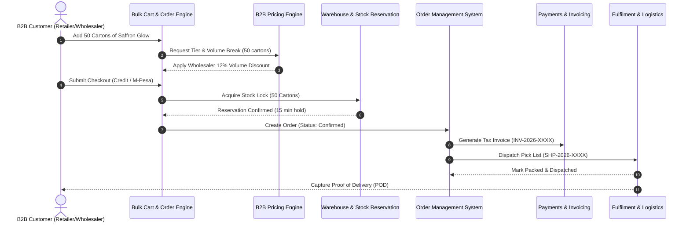

# Rekker Trade — Module Dependencies & Interaction Matrix

**System:** Rekker Trade (`trade.rekker.co.ke`)  
**Domain Structure:** Modular Monolith with In-Process Event Dispatches & Independent AI Service

---

## 1. Domain Interaction Matrix

| Upstream Module | Downstream Consumers | Coupling Mode | Data Exchanged |
|---|---|---|---|
| **Identity & Onboarding** | Pricing, Cart, Orders, CRM, Invoices | In-Process Service / DB Foreign Key | `businessId`, `businessType`, verification status, credit terms |
| **Product Catalogue** | Pricing, Inventory, Cart, Quotations | In-Process Service / DB Foreign Key | `sku`, packaging conversions, base price, stock levels |
| **Pricing Engine** | Cart, Checkout, Quotations, Invoices | Synchronous Calculation Function | Customer tier prices, quantity breaks, margin floors |
| **Inventory & Reservation** | Cart, Orders, Fulfilment, Analytics | Transactional Mutex / Row Locks | Stock allocation, reservation expiry, stock decrements |
| **Cart & Bulk Ordering** | Orders, Pricing, Inventory | Synchronous Validation | Validated order items, subtotal, tax (16% VAT), discounts |
| **Quotations & RFQs** | Orders, Pricing, Sales Rep CRM | State Transition Event | Approved counter-offer prices, margin check, validity period |
| **Orders & Fulfilment** | Invoices, Inventory, Logistics, Notifications | Async Event Bus & State Machine | Order confirmed, pick list generated, dispatch event |
| **Finance & Invoicing** | Payments, Credit Control, Audit | Append-Only Financial Ledger | Invoices generated, M-Pesa callbacks, credit utilization |
| **Trade AI Ecosystem** | All Core Business Domains | Tool-Call Registry & Read-Only APIs | Provenance records, demand forecasts, customer churn indicators |

---

## 2. Event Lifecycle & Trigger Chain

---

## 3. Dependency Isolation Rules
1. **Never Call External Storefront Databases:** Rekker Trade does not query `shop.rekker.co.ke`'s database directly. All synchronization is through REST APIs or webhook events.
2. **Never Permit Un-Validated Client Pricing:** Frontend cart states only provide intent; backend `pricingEngine` is the sole authority for gross price, discount percentage, tax, and order totals.
3. **Audit Log Coupling:** Every consequential mutation (business verification, price change, quotation issuance, credit limit update, stock adjustment) writes a synchronous record via `recordAuditEvent`.
