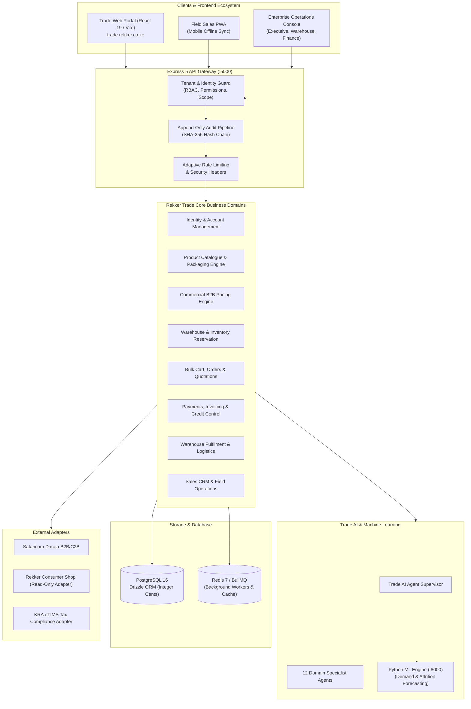

# Rekker Trade — System Architecture Specification

**System:** Rekker Trade (`trade.rekker.co.ke`)  
**Architecture Pattern:** Modular Monolith with Independent AI Services & Background Workers  
**Target Environment:** Node.js 22 + Express 5, React 19 + Vite, PostgreSQL 16 + Drizzle ORM, Python 3.12 FastAPI ML Engine

---

## 1. High-Level Architecture Topology

---

## 2. Core Architectural Domains

### Domain 1: Identity, Business Accounts & Access Control
- **Tenant Scope:** Every business (retailer, wholesaler, distributor) is isolated by `businessId`.
- **RBAC Matrix:** Strict resource permissions (e.g., `trade.orders:create`, `trade.pricing:manage`, `trade.credit:approve`).
- **Multi-Branch Hierarchy:** One business customer can maintain multiple branch delivery locations with dedicated branch managers and purchasing spending caps.

### Domain 2: Product Catalogue & Packaging Engine
- **Brand Hierarchy:** Saffron Milan, Bio Saff, Cornells, PetCare.
- **Packaging Conversions:** Mathematical, validated conversions between Base Units (piece/bottle), Packs, Cartons, and Cases.
- **Stock Availability:** Live stock, low stock thresholds, and warehouse-specific availability.

### Domain 3: Commercial Pricing & Commercial Rules Engine
- **Precedence Hierarchy:**
  1. Customer-Specific Negotiated Contract Pricing (highest priority)
  2. Approved Quotation Pricing (time-bounded)
  3. Tier / Category Pricing (Distributor > Wholesaler > Retailer)
  4. Volume Quantity Breaks (e.g., 50+ cartons = 12% off, 100+ cartons = 18% off)
  5. Base Catalogue Price (fallback)
- **Margin Protection:** Hard stop floor to prevent sales reps from offering sub-margin prices without Executive approval.

### Domain 4: Smart Cart, Checkout & Orders
- **Server-Side Revalidation:** All cart totals, taxes (16% VAT), discounts, and unit conversions are recomputed on the server; client prices are never trusted.
- **Stock Allocation:** Transactional reservations ensure stock is reserved at checkout and released if payment or approval expires.
- **Order State Machine:**
  `draft` → `submitted` → `awaiting_approval` → `awaiting_payment` → `confirmed` → `processing` → `picking` → `packed` → `dispatched` → `delivered` → `completed`.

### Domain 5: Quotations, Negotiations & Purchase Orders (RFQs)
- Customers request custom quotes for large volume orders.
- Sales reps adjust pricing with real-time gross margin indicators.
- One-click conversion from accepted quotation to binding purchase order.

### Domain 6: B2B Payments, Finance & Credit Control
- **Payment Methods:** M-Pesa Daraja STK Push, Bank Wire Transfer instructions, and 7/14/30-day Trade Credit.
- **Credit Governance:** Credit limits and credit terms must be formally approved by Finance Officers; credit accounts with overdue balances automatically place new orders on credit hold.

### Domain 7: Warehouse Fulfilment & Logistics
- Warehouse pick lists, packing confirmation, barcode/SKU verification, dispatch manifests, and proof of delivery (POD) capture.

### Domain 8: S-Tier AI Agent Ecosystem
- 12 specialist AI agents operating under StateGraph supervision:
  1. **Trade Assistant**: Natural language ordering, SKU resolution, and cart assembly.
  2. **Sales Intelligence**: Customer order frequency, churn risk, and cross-sell recommendations.
  3. **Demand Forecasting**: Rolling-origin ARIMA/XGBoost weekly demand projections.
  4. **Inventory Intelligence**: Stockout alerts, excess inventory, and replenishment triggers.
  5. **Pricing Intelligence**: Volume break optimization and margin impact simulations.
  6. **Customer Success**: Churn intervention and reorder reminders.
  7. **Procurement**: Raw material reorder recommendations and supplier comparison.
  8. **Finance Intelligence**: Overdue invoice aging and cash flow reconciliation.
  9. **Management Intelligence**: Executive sales briefings and gross margin summaries.
  10. **Customer Support**: Ticket routing and order status resolution.
  11. **Sales Rep Copilot**: Daily client visit briefings and route optimization.
  12. **Fraud & Anomaly Monitor**: Unusual purchase volumes, repeated failed payments, and credit abuse alerts.
